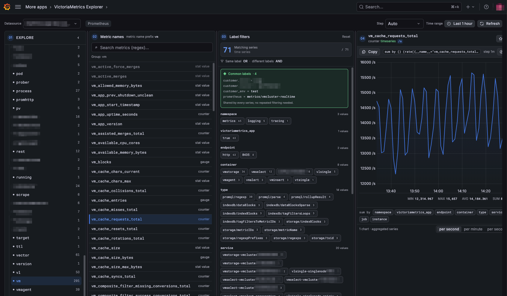

# VictoriaMetrics Explorer



VictoriaMetrics Explorer 是一个 Grafana App 插件（ID：`ahfuzhang-victoriametricsexplorer-app`），在 Grafana 中浏览 Prometheus 和 VictoriaMetrics 指标，无需手写 PromQL。它直接使用 Grafana 中已有的数据源：先按 Pod、Node 或指标名缩小范围，再按标签筛选，插件自动生成查询并选择图表类型。常用查询可以收藏到 Grafana 服务端，登录后在任意浏览器中使用。

- [功能](#功能)
- [安装](#安装)
- [配置](#配置)
- [已知限制](#已知限制)
- [本地开发](#本地开发)

## 功能

### 页面布局

插件在 Grafana 导航中添加 **VictoriaMetrics Explorer** 页面（`/a/ahfuzhang-victoriametricsexplorer-app`），Viewer 及以上角色可以访问。

顶部工具栏：

| 控件 | 说明 |
| --- | --- |
| Datasource | 选择 Prometheus 或 VictoriaMetrics 数据源，旁边显示数据源产品类型。默认选中 Grafana 的默认数据源 |
| Step | 查询步长：Auto（按指标自身的采集间隔）、15s、30s、1m、5m、15m、1h。同时作为 `rate()` / `increase()` 的窗口 |
| Time range | 查询时间范围，默认最近 1 小时 |
| Refresh | 重新加载；相对时间范围（如“最近 1 小时”）会移动到当前时间 |

工具栏下方是四栏，从左到右逐步缩小范围：

1. **Explore**：选择浏览范围（Pod 分组、Node、指标名前缀），或打开收藏；
2. **Metric names**：范围内的指标列表；
3. **Label filters**：所选指标的标签及取值；
4. **Visualization**：自动生成的图表。

栏间分隔线可以拖动或用方向键调整宽度，双击恢复默认；宽度保存在浏览器本地。第一栏可以折叠。

### 01 · Explore：选择浏览范围

每个分支首次展开时才加载数据，并各带一个正则过滤框（不区分大小写）。

- **By Pod**：读取 Pod 标签的全部取值，去掉 Kubernetes 生成的后缀（ReplicaSet 哈希、随机后缀、StatefulSet 序号、CronJob 时间戳等）后按工作负载前缀分组，例如 `api-7d4f8c9b7-k8pnx` 归入 `api`。所有 GitLab Runner 作业 Pod 归入 `runner` 一组。选中分组后，指标、标签和图表都限定为该前缀的 Pod（`pod=~"api-.*"`）。
- **By Node**：列出 Node 标签的全部取值，选中后限定为该节点上的序列。
- **By Name**：按指标名前缀分组；**All metrics** 列出全部指标。
- **My favorites**：个人收藏菜单，见 [收藏](#收藏)。

Pod 和 Node 使用的标签名可以在 [应用设置](#3-应用设置jsondata) 中修改。

### 02 · Metric names：指标列表

- 搜索框接受正则表达式（RE2，不区分大小写，匹配名称任意位置）；表达式非法时在输入框下提示。
- 后端读取每个指标最近 1 小时的数据，推断类型并显示在名称后：
  - **counter**：采样值只增不减；`_total` 结尾的指标直接视为 counter；
  - **gauge**：其他取值有变化的指标；
  - **histogram**：经典直方图的 `_bucket` / `_count` / `_sum` 合并为一行，只显示公共前缀，搜索成员名（如 `..._seconds_sum`）也能找到；
  - **stat value**：最近 1 小时内取值从未变化，例如版本号或配置项。
- 底部的 Counter / Gauge / Histogram / Stat 按钮可以只显示一种类型。最近 1 小时内始终为 0 的指标以灰色显示。
- 列表分页，滚动到底部时加载下一页。指标名和推断出的类型缓存在后端（见 `metricIndexCacheTTL`），因此翻页、搜索和排序不会再访问数据源。
- 在 By Pod 范围下，列表顶部出现 **Important Metrics** 入口（可用 `showImportantMetrics: false` 关闭），见 [Important Metrics](#important-metrics)。

### 03 · Label filters：标签筛选

- 标签和取值来自所选指标在当前范围内的真实序列，并显示每个取值的出现次数。
- 所有序列取值都相同的标签作为公共标签，单独显示在顶部。
- 同一标签内多选为 OR，不同标签之间为 AND。在其他已选条件下不会有结果的取值显示为禁用。
- 取值过多时只显示出现次数最多的一部分，并给出提示。

### 04 · Visualization：自动图表

后端按指标类型生成查询并选择图表。浏览范围、Pod / Node 和标签筛选都会写入查询：

| 指标类型 | 图表 | 查询（示意） |
| --- | --- | --- |
| counter | 时间序列曲线 | `sum(rate(m[step]))`，每秒速率；超过一半的速率采样值小于 1 时自动改用 `increase()`，按每分钟显示 |
| gauge | 时间序列曲线 | `sum(m)` |
| histogram | 热力图 + 桶表格 | `sum by (le) (rate(m_bucket[step]))`。表格列出每个桶的数量、占比和累计占比，并标出 p50–p99 所在的桶。也支持 VictoriaMetrics 的 `vmrange` 桶 |
| stat value、`_info` 指标 | 数值卡片 + 取值表 | 显示当前值，并列出出现过的每个取值及其对应的标签 |

图表的其他操作：

- **单位与统计**：根据指标元数据和名称推断单位；曲线右下角显示 min、max、avg，以及后端计算的 sum。
- **速率切换**：counter 图表底部可以在 per second（`rate`）、per minute（`increase`）和 per second (irate)（`irate`）之间切换；热力图可以在每秒和每分钟之间切换。
- **sum by**：counter 和 gauge 图表下方可以选择一个或多个标签，按标签值组合拆分曲线（`sum by (job, instance)`），图例显示每条曲线的标签值及其 min、max、mean、last。只列出在当前筛选条件下仍有多个取值的标签。
- **查询栏**：显示最终的 PromQL，可以一键复制，或在 Grafana Explore 中用相同的数据源、时间范围和步长打开。
- **★ Favorite**：把当前图表保存到收藏，见下文。

### Important Metrics

在 By Pod 下，可以按 YAML 配置展示一组预定义图表。这类图表通常来自现有的 Grafana dashboard，适合 .NET runtime 这类有固定指标集合的应用。

- 先选中某个 Pod 分组，再点击 **Important Metrics**，可以查看该分组匹配的图表；不选分组直接点击，则汇总所有带 Pod 标签的序列。点击普通指标名可以回到单指标浏览。
- 图表依赖的指标必须全部出现在当前 Pod 范围内，缺少指标的图表不显示。
- 图表使用 Grafana 原生面板渲染（`timeseries`、`stat`、`piechart`），保留统计值、环形图、堆积、双坐标、单位、图例和字段覆盖等设置。
- 第三栏中已选的标签筛选会带入这些图表的查询。

仓库自带 [provisioning/plugins/config/metrics](provisioning/plugins/config/metrics)：由 .NET runtime dashboard 拆出的 7 个类别、45 张图、83 条查询，使用 `language: promql`，兼容 Prometheus 和 VictoriaMetrics。启用方式见 [Important Metrics 图表目录](#4-important-metrics-图表目录)。

### 收藏

收藏按用户保存在 Grafana 服务端（User Storage API），不依赖浏览器本地存储。

- **结构**：第一栏的 **My favorites** 是文件夹和收藏组成的菜单。每个收藏最多包含 20 个查询，每个查询包含 1–10 条语句；语句记录表达式、单位、图表类型（Time series / Stat / Heatmap）以及来源的浏览范围。
- **保存**：点击图表上的 ★ Favorite，对话框会预填当前图表的最终表达式、单位和图表类型。可以保存到新收藏或已有收藏，追加查询或替换某个已有查询。
- **查看**：打开收藏后，第二栏显示查询列表，其余区域按查询从上到下逐条绘图；点击列表中的查询可以滚动到对应图表。收藏使用工具栏当前的数据源、时间范围和 Step 执行，因此同一个收藏可以在不同数据源上查看。从图表保存的语句中，`rate()` / `increase()` / `irate()` 的窗口会跟随当前 Step；手写表达式保留原窗口。
- **编辑与管理**：编辑对话框可以修改查询中的语句，并逐条试运行；管理对话框可以新建文件夹，以及重命名、排序、移动（拖放或键盘）和删除文件夹与收藏。
- **并发安全**：每次写入都以资源版本为条件。多个窗口或浏览器同时修改时不会互相覆盖：冲突的保存会在最新数据上重放，丢失响应的保存会先检查结果再决定是否重试。
- **离线可用**：数据源不可用时，收藏菜单仍然可以浏览和管理。
- **容量限制**：文件夹和收藏合计 500 个，最大嵌套深度 8 层，名称最长 128 个字符，单条表达式最大 16 KiB。

保存收藏需要 Grafana 12.3.0 或更高版本。更低版本中收藏为只读，★ Favorite 按钮禁用，原因参见 [User Storage 验证记录](docs/userstorage_p0.md)。

### 后端与安全

- **单一插件**：Explorer 不包含自己的数据源插件，也不保存数据源地址或凭据。它通过 Grafana 数据源代理访问已配置的数据源，URL、认证、TLS 和 VictoriaMetrics 集群租户路径都由 Grafana 数据源负责。
- **服务账号**：后端用服务账号访问数据源，并非当前用户的身份，所以 Grafana 按用户设置的数据源权限不会在后端生效。可以用 `datasourceUids` 白名单限制范围；前端选择器还会隐藏当前用户在 Grafana 中看不到的数据源。
- **缓存**：后端使用进程内缓存，所有数据源共享容量。缓存的数据包括指标名列表、推断出的类型和标签筛选结果；缓存查看和清除接口仅限 Admin。
- **保护限制**：对单次扫描的序列数、标签取值数、上游响应大小和每个数据源的并发请求数设有上限，避免大查询拖垮浏览器或数据源。超限时结果标记为截断。
- **查询语法**：为 Prometheus 数据源生成 PromQL；为 VictoriaMetrics 数据源生成的查询在必要时使用 MetricsQL 扩展。

## 安装

### 环境要求

| 组件 | 要求 |
| --- | --- |
| Grafana | 11.6.0 及以上；保存收藏需要 12.3.0 及以上 |
| 数据源 | Grafana 内置的 Prometheus 数据源（`prometheus`），和/或官方 VictoriaMetrics 数据源插件（`victoriametrics-metrics-datasource`） |
| 构建工具 | Go 1.27、Node.js 22（见 [.nvmrc](.nvmrc)） |

插件未签名，Grafana 需要显式允许加载（见下文）。

### 1. 构建

```sh
npm ci
npm run build    # 前端输出到 dist/

# 后端二进制必须命名为 gpx_victoriametricsexplorer_<os>_<arch>，与运行 Grafana 的系统和架构一致
CGO_ENABLED=0 GOOS=linux GOARCH=amd64 go build -trimpath -ldflags="-s -w" \
  -o dist/gpx_victoriametricsexplorer_linux_amd64 .
```

ARM64 服务器上把 `GOARCH` 和文件名中的 `amd64` 换成 `arm64`。构建完成后，`dist/` 即为完整的插件目录。

### 2. 安装到 Grafana

把 `dist/` 复制到 Grafana 插件目录下名为插件 ID 的子目录，并允许加载未签名插件：

```sh
PLUGIN_DIR=/var/lib/grafana/plugins/ahfuzhang-victoriametricsexplorer-app
mkdir -p "$PLUGIN_DIR"
cp -r dist/. "$PLUGIN_DIR"/
chmod +x "$PLUGIN_DIR"/gpx_victoriametricsexplorer_linux_*
```

```ini
# grafana.ini
[plugins]
allow_loading_unsigned_plugins = ahfuzhang-victoriametricsexplorer-app
```

重启 Grafana，然后在 **Administration → Plugins and data → Plugins** 中找到 **VictoriaMetrics Explorer** 并启用，或使用 [provisioning 文件](#3-应用设置jsondata) 自动启用。启用后，导航中会出现 **VictoriaMetrics Explorer**。

使用 Docker 时，可以把 `dist/` 挂载到插件目录，用环境变量完成同样的设置：

```sh
docker run -d -p 3000:3000 \
  -v "$PWD/dist:/var/lib/grafana/plugins/ahfuzhang-victoriametricsexplorer-app" \
  -v "$PWD/provisioning/plugins:/etc/grafana/provisioning/plugins" \
  -e GF_PLUGINS_ALLOW_LOADING_UNSIGNED_PLUGINS=ahfuzhang-victoriametricsexplorer-app \
  -e GF_PLUGINS_PREINSTALL_SYNC=victoriametrics-metrics-datasource \
  -e GF_FEATURE_TOGGLES_ENABLE=accessControlOnCallResource,externalServiceAccounts \
  -e GF_AUTH_MANAGED_SERVICE_ACCOUNTS_ENABLED=true \
  grafana/grafana:12.3.1
```

`GF_PLUGINS_PREINSTALL_SYNC` 在启动时安装 VictoriaMetrics 数据源插件，只使用 Prometheus 时可以去掉。最后两行用于启用 Grafana 托管的服务账号，见 [服务账号](#2-服务账号)。

### 快速体验

仓库的 [docker-compose.yml](docker-compose.yml) 会启动 Grafana、VictoriaMetrics 和 Prometheus，并配置好两个数据源、服务账号和 Important Metrics 目录。Prometheus 采集自身指标，可以直接用来浏览：

```sh
npm ci
make run    # 需要 Docker；构建与 Docker 引擎架构匹配的插件后启动
```

启动后访问 <http://localhost:3000/a/ahfuzhang-victoriametricsexplorer-app>（账号 `admin` / `admin`）。`make stop` 停止服务，`make logs` 查看 Grafana 日志。

## 配置

### 1. 数据源

在 Grafana 的 **Connections → Data sources** 中添加任意一种数据源：

| 数据源 | Grafana 类型 | 查询语言 |
| --- | --- | --- |
| Prometheus | `prometheus`（Grafana 内置） | PromQL |
| VictoriaMetrics | `victoriametrics-metrics-datasource`（需安装官方数据源插件） | PromQL / MetricsQL |

两种数据源可以同时存在，在 Explorer 顶部的选择器中切换。URL、认证、TLS 和 VictoriaMetrics 集群租户路径都在 Grafana 数据源中配置，Explorer 无需重复配置。示例见 [provisioning/datasources](provisioning/datasources)。

### 2. 服务账号

Explorer 后端以服务账号的身份访问数据源，需要 `datasources:read` 和 `datasources:query` 权限（Viewer 角色即可）。以下两种方式任选其一：

**方式 A：Grafana 托管的服务账号**（仅支持组织 1）

开启以下设置后，Grafana 会自动为插件创建服务账号：

```ini
[feature_toggles]
enable = externalServiceAccounts

[auth]
managed_service_accounts_enabled = true
```

**方式 B：手动配置 token**（任意组织）

1. 在 **Administration → Users and access → Service accounts** 中创建一个 Viewer 角色的服务账号，并为它生成 token；
2. 打开 **Administration → Plugins and data → Plugins → VictoriaMetrics Explorer → Configuration**，粘贴 token，点击 **Save & test**。页面会立即检查 token 是否可用，并显示可访问的数据源数量。

token 加密保存，无法读回；配置后优先于托管服务账号。也可以在 provisioning 文件的应用条目中设置：

```yaml
apps:
  - orgId: 1
    type: ahfuzhang-victoriametricsexplorer-app
    secureJsonData:
      serviceAccountToken: $VMX_SERVICE_ACCOUNT_TOKEN
```

应用设置按组织保存。在多个组织中使用时，需要在每个组织分别启用应用并配置该组织的 token。

### 3. 应用设置（jsonData）

应用设置通过 provisioning 文件配置，示例见 [provisioning/plugins/app.yaml](provisioning/plugins/app.yaml)：

```yaml
apiVersion: 1

apps:
  - orgId: 1
    type: ahfuzhang-victoriametricsexplorer-app
    enabled: true
    jsonData:
      datasourceUids:          # 不设置时允许组织中所有受支持的数据源
        - <datasource-uid>
      podLabel: pod
      namespaceLabel: namespace
      nodeLabel: node
      clusterLabel: cluster
      defaultTimeRange: 1h
      cacheTTL: 2m
      metricIndexCacheTTL: 30m
      localCacheSize: 1GB
      upstreamTimeout: 120s
      showImportantMetrics: true
```

| 字段 | 默认值 | 说明 |
| --- | --- | --- |
| `datasourceUids` | 不限制 | 允许 Explorer 访问的数据源 UID 白名单。后端以服务账号身份查询，Grafana 按用户设置的数据源权限不会生效；需要限制用户能访问的数据时，请设置此项 |
| `podLabel` | `pod` | By Pod 使用的标签名 |
| `nodeLabel` | `node` | By Node 使用的标签名 |
| `namespaceLabel` | `namespace` | 命名空间标签名，供 Important Metrics 模板 `{{label:namespace}}` 使用 |
| `clusterLabel` | `cluster` | 集群标签名，供 Important Metrics 模板 `{{label:cluster}}` 使用 |
| `defaultTimeRange` | `1h` | 请求未携带时间范围时，后端使用的回溯窗口 |
| `cacheTTL` | `2m` | 标签筛选结果的缓存时间 |
| `metricIndexCacheTTL` | `30m` | 每个范围（指标名前缀、Pod 分组、Node）的指标名列表及推断类型的缓存时间。新指标在缓存过期后出现 |
| `localCacheSize` | `1GB` | 后端进程内缓存容量，所有数据源共享，按需分配。KB / MB / GB 以 1024 为底，纯数字表示字节，最小 32MB |
| `upstreamTimeout` | `120s` | 后端发往数据源的单个请求的超时。Grafana 的 `[dataproxy] timeout`（默认 30s，环境变量 `GF_DATAPROXY_TIMEOUT`）同时生效，需要更长的超时时请一并调大 |
| `showImportantMetrics` | `true` | 是否在 By Pod 范围下展示 **Important Metrics** 入口。设为 `false` 时隐藏入口，后端也不再返回图表目录中的图表 |

时长字段使用 Go 时长格式，例如 `90s`、`5m`、`1h`。配置值非法时，应用无法启动。

### 4. Important Metrics 图表目录

Important Metrics 默认关闭。启用步骤如下：

1. 准备图表目录，每个 `.yaml` / `.yml` 文件对应一个类别，格式见 [图表配置文档](docs/metric_config.md)。可以直接使用仓库的 [provisioning/plugins/config/metrics](provisioning/plugins/config/metrics)。
2. 图表目录随 provisioning 目录一起部署：把 `provisioning/plugins` 挂载或复制到 Grafana 的 `/etc/grafana/provisioning/plugins` 后，图表目录位于 `/etc/grafana/provisioning/plugins/config/metrics`，无需单独挂载。Grafana 只解析 `provisioning/plugins` 第一层的 `.yaml` / `.yml` 文件，不会把子目录中的图表配置当作插件配置。在 Kubernetes 中可以使用 ConfigMap，目录中的文件符号链接也会被加载。
3. 为 Grafana 进程设置环境变量：

   ```sh
   VMX_METRIC_CONFIG_DIR=/etc/grafana/provisioning/plugins/config/metrics
   # Grafana 12.4+ 默认不向插件进程传递环境变量，需要显式转发：
   GF_PLUGINS_FORWARD_HOST_ENV_VARS=ahfuzhang-victoriametricsexplorer-app
   ```

4. 重启 Grafana。

插件启动时一次性严格加载目录，修改后需要重启 Grafana 或插件后端。目录不可读或任一文件校验失败时，插件启动失败；未设置 `VMX_METRIC_CONFIG_DIR` 时不加载图表。

不需要 Important Metrics 时，在应用配置中设置 `showImportantMetrics: false`，界面上不再显示 Important Metrics 入口。

YAML 中的查询和展示设置由 Go 后端解析、校验，并绑定当前的 Pod 范围和标签筛选；前端按配置调用 Grafana 面板渲染器。设置 `language: metricsql` 的图表只在 VictoriaMetrics 数据源上显示。

### Grafana 设置汇总

| 设置 | 环境变量 | 用途 |
| --- | --- | --- |
| `[plugins] allow_loading_unsigned_plugins` | `GF_PLUGINS_ALLOW_LOADING_UNSIGNED_PLUGINS` | 必需：加载未签名插件 |
| `[feature_toggles] enable = externalServiceAccounts` | `GF_FEATURE_TOGGLES_ENABLE` | 方式 A：托管服务账号 |
| `[auth] managed_service_accounts_enabled` | `GF_AUTH_MANAGED_SERVICE_ACCOUNTS_ENABLED` | 方式 A：托管服务账号 |
| `[plugins] forward_host_env_vars` | `GF_PLUGINS_FORWARD_HOST_ENV_VARS` | Grafana 12.4+ 使用 Important Metrics 时需要 |
| `[dataproxy] timeout` | `GF_DATAPROXY_TIMEOUT` | 需要超过 30s 的查询时调大 |
| — | `VMX_METRIC_CONFIG_DIR` | Important Metrics 图表目录 |

## 已知限制

- 自动生成的查询会根据数据源类型选择兼容语法；收藏中手写的表达式保留原文。包含 MetricsQL 专有语法的收藏切换到 Prometheus 数据源后，需要改写为 PromQL。
- histogram 视图面向经典的 `_bucket` / `_count` / `_sum` 指标，尚不支持 Prometheus native histogram。
- 方式 A 的托管服务账号只在组织 1 中可用，其他组织请使用方式 B。
- Grafana 12.3.0 以下版本中收藏为只读。

## 本地开发

安装 Go 1.27 和 Node.js 22，运行 `npm ci` 安装前端依赖后执行 `make run`。修改代码后再次运行 `make run` 会重新构建插件并重建 Grafana 容器。`make help` 列出所有目标。

验证命令：

```sh
go test -race ./...
npm run typecheck
npm test -- --runInBand
npm run build
```

可选：使用 Prometheus 发行包中的 `promtool`，在真实查询引擎中验证生成的 PromQL：

```sh
PROMTOOL_PATH=/path/to/promtool go test -tags=integration ./pkg/resource -run TestPrometheusZeroCounterQuery
```

收藏相关的端到端测试和 User Storage 接口契约检查需要运行中的 Grafana（`make run`）：

```sh
make test-e2e            # 使用本机安装的 Google Chrome
make test-userstorage
```
